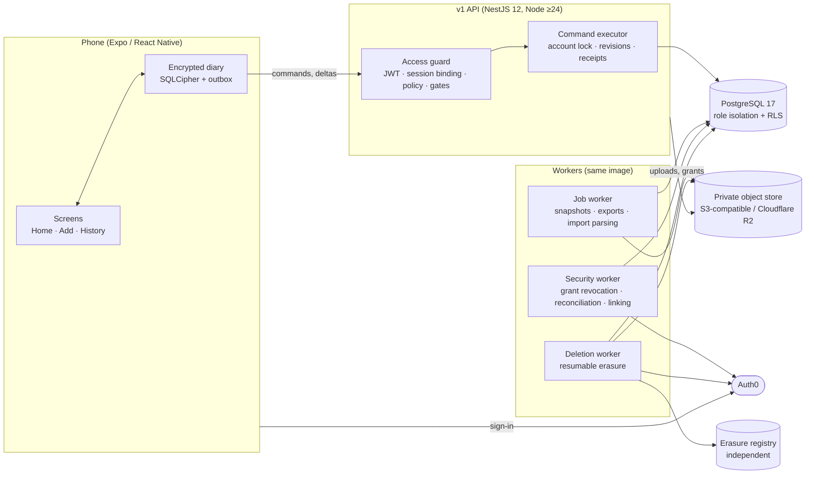

<p align="center">
  
</p>

<h1 align="center">Jotbun</h1>

<p align="center">
  A private, offline-first spending diary for Thailand.<br>
  Thai · English · Vietnamese · Thai baht · iOS and Android
</p>

<p align="center">
  <a href="https://github.com/mygogocash/jotbun/actions/workflows/backend.yml"></a>
  
  
</p>

Jotbun helps people see where their money goes, one entry at a time. You log what you spend and earn, and Jotbun keeps exact totals, budgets and history.
- **No bank connection:** your data is only what you type in or import from a file you choose.
- **Works offline:** it syncs when you're back online.
- **Yours to keep or remove:** you can export your data or delete your account.

> **Status: v0.1.0 local pre-release.**
> - **Done:** the v1 API, its workers and the app journey are built and pass the full local test gate, and hosted CI is green.
> - **Not deployed yet.** Hosted proofs (real Auth0, PostgreSQL hosting, R2 storage, devices and a staging target) are still pending. Every hosted or native check is recorded as *SKIPPED*.
> - **Still switched off:** uploads, account linking and password-reset recovery, until their gates pass.
>
> See [Project status](#project-status).

## Contents

- [Features](#features)
- [Architecture](#architecture)
- [Repository layout](#repository-layout)
- [Getting started](#getting-started)
- [Testing and the quality gate](#testing-and-the-quality-gate)
- [Database and migrations](#database-and-migrations)
- [v1 API overview](#v1-api-overview)
- [Security and privacy](#security-and-privacy)
- [Project status](#project-status)
- [Documentation](#documentation)
- [How we work](#how-we-work)
- [Legacy stack](#legacy-stack)
- [Licence](#licence)

## Features

**Money diary**
- **Records:** expense, income, and transfers between your own wallets, each with a date and an optional merchant and note. Expenses and income also have a category.
- **Exact money:** amounts are integer satang end to end, never floating point. Dates are Bangkok calendar dates.
- **Wallets:** opening balances are never counted as income.
- **Categories:** built-in and custom, with archive and unarchive.
- **Corrections:**
  - Edits are version-checked: if another device changed the record, you see a conflict and nothing is silently overwritten.
  - A delete can be undone, and a deleted record can be restored for 30 days.
- **Budgets:** monthly, with per-category sub-limits.
- **History:** filterable, with keyset pagination and month summaries.

**Offline-first sync**
- **Encrypted on-device diary:** one per account, encrypted with SQLCipher, with the key in protected native storage.
- **Device first:** every save lands on the device first and goes out through an outbox.
- **Pending stays visible:** pending money is shown apart from confirmed money, and "saving" never looks saved.
- **Idempotent commands:** every write is a command with its own key, so a retry after a lost response can never commit twice.
- **Sync:** the server sends ordered change deltas and consistent snapshots. After reconnecting, the app reconciles the outcome of every command it sent.
- **Web:** the web build keeps no diary and works online only.

**Imports and receipts** (built; switched off until hosted storage is proven, and the review screen is not routed yet)
- **Upload:**
  - accepts CSV, XLSX, JPEG, PNG and WebP up to 12 MiB;
  - streams into private quarantine;
  - enforces per-account quotas.
- **Parsing:**
  - runs in a bounded, permission-limited child process;
  - parses money and dates exactly, including Thai and Buddhist-era dates;
  - guesses nothing, and flags ambiguous values.
- **Review:** you review every row, and possible duplicates are shown as advice only. Nothing is saved until you confirm.
- **Confirmation:** resumable, in batches of up to 500 rows from a frozen selection of up to 5,000.
- **Receipts:** retained with consent and versioned ownership, viewable through five-minute private grants.

**Privacy and account**
- **Sign-in:** Auth0, with session bindings, short-lived proofs for sensitive actions, policy acceptance and "sign out everywhere".
- **Account linking:** explicit, and off until the tenant proof passes.
- **Export:** a private export file, kept for 24 hours and downloaded through a short-lived grant.
- **Deletion:**
  - Account deletion is resumable.
  - An independent erasure registry means a restored backup never brings an erased account back.
  - Every data type has a retention job.

**App**
- Expo SDK 58 and React Native 0.88 with Expo Router.
- Thai and English, with partial Vietnamese (missing strings show in English); light and dark themes.
- The **Bun diary** redesign is planned and in progress on a branch: a lavender stage, cream cards, receipt slips and the Jotbun mascot.

## Architecture



Key design choices:
- **Every business write is one command** in one account-locked transaction. Under the lock, the command:
  - checks the session and policy;
  - allocates revisions;
  - writes a change log;
  - stores a compact idempotency receipt.
- **Database access is narrow:**
  - Each process connects with its own login, granted only the group roles it needs: `gogospend_app`, `gogospend_bootstrap`, `gogospend_jobs`, `gogospend_leased_read`, `gogospend_security` and `gogospend_erasure_registry`.
  - Row-level security keeps every query inside the caller's account.
- **Background work is fenced:**
  - Each job runs under a lease (30 s by default, renewed by a heartbeat every 10 s) and has a bounded number of attempts: 3 for snapshots, exports and import parsing.
  - Objects are registered before upload, so late or cancelled output gets swept.
  - Stopping a worker gives the job back without spending an attempt.
- **Operational gates** (`writes`, `imports`, `ocr`, `uploads`, `jobs`) pause one area with a 503 and a retry hint. Set `OPERATIONAL_PAUSE` and restart; no code deploy is needed.
- **One Docker image** holds only the release graph: the v1 API, three workers, the parser children and the migration CLI. Legacy code is never in it.

The full design is in [backend architecture](docs/design/backend-architecture-2026-10-17.md).

## Repository layout

```
apps/
  api/                 NestJS service: v1 API, workers, migrations, release image
    drizzle/           hand-written SQL migrations 0001–0018 and the journal
    src/v1/            v1 app root (isolated from the legacy stack)
    src/{auth,policies,commands,wallets,categories,transactions,budgets,history,
         summary,sync,jobs,storage,imports,attachments,exports,privacy,health,
         database,common}/
    Dockerfile         release image (Node 24.22.0, pinned by digest)
  app/                 Expo app (Expo Router)
    app/               routes: onboarding, login, /spend (home, add, all; import is legacy-only)
    src/spend/v1/      v1 data layer: resources, diary session, imports, view models, money
    src/screens/v1/    v1 screens and render tests
    src/storage/       encrypted per-account diary (SQLCipher)
    src/sync/          outbox, retry and reconciliation
    src/theme/ src/i18n/ ...
packages/
  contracts/           shared v1 contracts (TypeScript source, used by both apps)
scripts/
  dev.mjs dev-v1.mjs   local runners (legacy stack; v1 API with local PostgreSQL)
  ops/                 backup, recovery inventory, restore rehearsal, performance smoke
  ci/                  Linux native-bindings helper and workflow parity test
docs/                  plans, progress receipts, operations runbooks, brand, design
vendor/                read-only snapshots of the original GoGoCash spend sources
.github/workflows/     backend CI (gate, SQL + ops, release image smoke)
compose.postgres.yml   local PostgreSQL 17 for the v1 API and its tests
```

## Getting started

### Prerequisites
- **Node.js 24 or later.** The local gate ran on Node 26; CI and the release image use Node 24.22.0. npm 11.
- **Docker,** for the local PostgreSQL 17 container.
- **Optional:** Xcode with an iOS simulator (iOS builds) or Android Studio.

### Install

```bash
npm ci
```

The lockfile records only the darwin-arm64 native bindings. On Linux, also run `node scripts/ci/linux-native-bindings.mjs swc unrs sharp`, as CI does.

### Local database

```bash
npm run db:v1:up
```

This starts `gogospend-postgres-v1-local` on `127.0.0.1:55432` from `compose.postgres.yml`. The container listens on loopback only and has its own volume. Integration tests create and drop their own `gogospend_test_*` databases.

### Run the v1 API locally

```bash
npm run dev:v1
```

This:
1. builds the API;
2. migrates the local `gogospend_v1` database;
3. creates a least-privilege dev login with a random password;
4. starts the v1 API on `http://127.0.0.1:8091`, using an in-memory object store. No job worker runs, so snapshots stay pending.

Auth0 isn't configured until a non-production tenant exists. Until then, token-protected routes fail closed with a 503, while public routes work.

`dev:v1` migrates `gogospend_v1`. Until the first deployment, migrations are still edited in place, so the journal check will sometimes refuse an existing database. When it does, check the database holds nothing you need, then recreate it.

### Run the app

Web:
```bash
npm run web -w gogospend-app
```

iOS Simulator (development build):
```bash
cd apps/app
LANG=en_US.UTF-8 LC_ALL=en_US.UTF-8 npx expo run:ios
```

Things to know:
- **API address:** the app calls the v1 API at `http://localhost:8091` unless `EXPO_PUBLIC_V1_API_URL` is set.
- **Development build required:** the app uses `expo-sqlite` with SQLCipher, so Expo Go won't work.
- **Bundle identifier:** the iOS bundle identifier is still an owner decision. For local builds, add an untracked `apps/app/app.config.js` that sets a placeholder `ios.bundleIdentifier`.
- **Locale:** CocoaPods needs a UTF-8 locale.
- **Without Auth0:** the app shows onboarding, then "Sign-in is not configured for this local installation".

## Testing and the quality gate

Every change runs the full gate:

```bash
npm run typecheck
npm run typecheck:app
npm run test:api
npm run test:db
npm run test:app
npm run test:unit
npm run test:dev
GOGOSPEND_OPS_REQUIRE_DB=1 npm run test:ops
npm run test:render -w gogospend-app
npm run build -w gogospend-api
node apps/api/scripts/release-graph.mjs check
npm run export:web -w gogospend-app -- --max-workers 2
git diff --check
```

| Suite | What it covers | Count at v0.1.0 |
| --- | --- | --- |
| `test:api` | API unit tests (Jest, 41 suites) | 929 |
| `test:db` | SQL integration against real PostgreSQL 17: roles, RLS, routines, concurrency (40 suites) | 681 |
| `test:unit` | Pure app logic (Node test runner) | 263 |
| `test:render` | App screens (Vitest + happy-dom) | 66 |
| `test:ops` | Backup, recovery inventory, restore rehearsal, readiness receipts, performance smoke, CI checks | 107 |
| `test:app`, `test:dev` | App API client, local runners | 28, 7 |

These counts are the same in the last recorded local gate (Node 26.10.0) and in hosted CI on `1107731` (Node 24.22.0).

CI (`.github/workflows/backend.yml`) runs three jobs on Ubuntu with Node 24.22.0:
1. typecheck, unit, render, build and web export;
2. SQL integration and ops against a PostgreSQL 17 container;
3. a release-image build with a smoke test. The image is never pushed.

Tests are written first. Each task records:
- a behavioural RED (assertions failing against compile-safe seams, never import errors);
- the GREEN result;
- mutation checks;
- an independent review.

Receipts are in `docs/implementation/`.

## Database and migrations

Migrations are hand-written SQL in `apps/api/drizzle/`, with a Drizzle journal, and a Drizzle schema used for drift checks. The API never migrates on startup: `db:migrate` is a release step.

| # | Migration | Adds |
| --- | --- | --- |
| 0001 | identity | accounts, provider identity aliases, the per-account lock row, group roles and RLS |
| 0002 | rate_limits | shared rate-limit buckets |
| 0003 | sessions_policies | session bindings, bootstrap, reauth challenges, consents, policies, blocked principals |
| 0004 | jobs_security | the durable job queue, and global logout with a provider-cleanup hold |
| 0005 | commands | command receipts (idempotency), the change log, entity heads, audit events |
| 0006 | wallets_categories | wallets and categories |
| 0007 | transactions | expense, income and transfer records |
| 0008 | budgets | monthly budgets and category sub-limits |
| 0009 | jobs_storage | the fenced job runtime (leases, runtime bounds), object publication registry, leased reads |
| 0010 | sync | ordered deltas and snapshots: snapshot manifests and chunks, pruning watermark, retention |
| 0011 | auth_events | verified provider security events and their reconciliation |
| 0012 | account_linking | explicit account linking (routines only, no new tables) |
| 0013 | exports | private export records |
| 0014 | import_intake | upload quarantine and quotas |
| 0015 | privacy | deletion requests, erasure registry, retention |
| 0016 | import_candidates | parsed previews and candidates |
| 0017 | attachments | retained receipts and their links to records |
| 0018 | import_confirmation | frozen selections and per-row progress |

## v1 API overview

All routes are under `/v1` except health. Every route declares one access class, checked at startup. Business writes (records, wallets, categories, budgets, imports, exports, snapshot requests, receipts, linking, global logout and deletion) are idempotent: they need an `Idempotency-Key` header (a UUID), and versioned edits also need `If-Match`. Sign-in steps, sign-out, policy acceptance and privacy preferences are not commands.

| Area | Routes |
| --- | --- |
| Auth and account | `POST auth/challenges`, `auth/bootstrap`, `auth/proofs`, `auth/provider-events`, `auth/deletion-receipt`; `GET me`; `POST me/logout`, `me/global-logout`, `me/identities`, `me/deletion` |
| Policies | `GET policies`; `POST me/policy-acceptances`; `PUT me/privacy-preferences` |
| Wallets | `GET/POST wallets`; `GET/PATCH wallets/:id`; `POST wallets/:id/archive`, `/unarchive` |
| Categories | `GET/POST categories`; `POST categories/builtins`; `PATCH categories/:id`; `POST categories/:id/archive`, `/unarchive` |
| Records | `POST transactions`; `GET/PATCH/DELETE transactions/:id`; `POST transactions/:id/restore` |
| Budgets, history, summary | `GET/PUT budgets/:month`; `GET history`; `GET summary` |
| Commands | `POST commands/status` |
| Sync | `GET sync/changes`; `POST sync/snapshots`; `GET sync/snapshots/:id`, `sync/snapshot-chunks/:grant` |
| Exports | `POST exports`; `GET exports/:id`, `exports/:id/grant`, `export-files/:grant` |
| Imports | `POST imports`; `GET imports/:id`, `imports/:id/preview`; `PATCH imports/:id/rows`; `POST imports/:id/selections`, `imports/:id/confirmations`; `GET imports/:id/selections/:selectionId` |
| Receipts | `POST/PUT/DELETE transactions/:id/attachment`; `GET attachments/:id/grant`, `attachment-files/:grant` |
| Health | `GET /live` (process only), `GET /ready` (database, draining, readiness receipts) |

## Security and privacy

- **Identity:**
  - Access tokens are verified against Auth0 (issuer, audience, client).
  - Accounts are keyed by `(issuer, sub)` and are never linked by email.
  - Sessions are server-side bindings with idle and absolute lifetimes.
  - Sensitive actions need a fresh, single-use proof.
- **Data access:**
  - Each process uses its own database login with narrow group roles, and row-level security keeps every query inside the caller's account.
  - Financial data is never exposed through client SQL or a generic data API.
  - Workers read only through narrow, lease-checked routines.
- **Logs** record error class names and codes, never messages or payloads (`failureName`). Only a `ConfigurationError` prints its message. Unit tests in CI and the release-image smoke check that no synthetic secret reaches the output.
- **Uploads:**
  - Files go to private quarantine.
  - Parsing runs in a child process with no network, no writes and a scrubbed environment.
  - On runtimes that can't deny network access, parsing fails closed.
- **File access:** objects are served only through short-lived, session-bound grants, never public URLs.
- **Deletion:**
  - An independent erasure registry records erased accounts.
  - Every data type has a retention job.
  - A restore rehearsal proves erased accounts stay erased.

## Project status

v0.1.0 is a **local pre-release**. What's built and verified locally:

| Area | Tasks | Local | Hosted / device |
| --- | --- | --- | --- |
| Foundation and auth | F1–F6c | Done and reviewed | SKIPPED: Auth0 tenant and native proofs |
| Money | M1–M5 | Done and reviewed | SKIPPED: device journeys, visual approval |
| Offline sync | S1–S4 | Done and reviewed | SKIPPED: device checks, real storage |
| Jobs and storage | P1 | Done and reviewed | SKIPPED: hosted R2 gate |
| Imports | P2a, P2b, P2c, P3 | Done and reviewed; follow-ups open | SKIPPED: hosted storage; import flag off |
| Export and erasure | P4, P5 | Done and reviewed | SKIPPED: hosted deletion and storage proofs |
| Backup and restore | P6a | Done (local rehearsal) | SKIPPED: hosted PITR, measured RPO/RTO |
| Release package | P6b | Done (image, CI, gates, runbooks) | Hosted CI green; staging smoke SKIPPED |

**Next:**
- The Bun diary app redesign, in progress.
- Hosted proofs, once providers are authorized:
  - an Auth0 non-production tenant;
  - a Neon project;
  - R2 test scopes;
  - a staging target.
- Owner decisions:
  - moving the worker runtime to Node ≥25, which the import parser sandbox needs;
  - regenerating the lockfile with Linux native bindings;
  - the iOS bundle identifier.

See [CHANGELOG.md](CHANGELOG.md) and the [handover](docs/implementation/handover.md) for the full list.

## Documentation

| Topic | Where |
| --- | --- |
| Plans (master and four stages) | [`docs/superpowers/plans/`](docs/superpowers/plans/) |
| Build receipts per task | [`docs/implementation/backend-progress.md`](docs/implementation/backend-progress.md) |
| Handover and open work | [`docs/implementation/handover.md`](docs/implementation/handover.md) |
| Architecture | [`docs/design/backend-architecture-2026-10-17.md`](docs/design/backend-architecture-2026-10-17.md) |
| Release, rollback, incident | [`docs/operations/`](docs/operations/) |
| Deletion, retention, restore | [`docs/operations/`](docs/operations/) |
| Auth0 runbook and proofs | [`docs/operations/auth0-runbook.md`](docs/operations/auth0-runbook.md), [`docs/implementation/`](docs/implementation/) |
| Beta readiness receipts | [`docs/implementation/beta-receipts.md`](docs/implementation/beta-receipts.md) |
| Brand | [`docs/brand/README.md`](docs/brand/README.md) |
| Local development and verification | [`docs/LOCAL_DEVELOPMENT.md`](docs/LOCAL_DEVELOPMENT.md), [`docs/LOCAL_VERIFICATION.md`](docs/LOCAL_VERIFICATION.md) |
| Extraction history and cutover | [`docs/EXTRACTION.md`](docs/EXTRACTION.md), [`docs/CUTOVER.md`](docs/CUTOVER.md) |

## How we work

- **Every task:**
  - test first, with a behavioural RED, then GREEN;
  - run the full gate;
  - record receipts;
  - an independent review, with findings fixed test-first.
- **Migrations** take the next free number when integrated. Undeployed migrations are edited in place.
- **Needs the owner's authorization:**
  - provider resources, credentials or paid services;
  - dependency or lockfile changes;
  - visual approval of new screens and copy;
  - pushes, PRs, merges and releases.
- **Never touched:** `vendor/` (read-only snapshots) and the legacy Mongo data.
- **Never done:**
  - automatic fallback to the old stack;
  - a bare `git stash` (worktrees share the stash).

## Legacy stack

The repository started as an extraction of GoGoCash's spend feature.
- **Still runnable:** `npm run dev` starts the original NestJS + MongoDB `/spend` service with the web client (see [local development](docs/LOCAL_DEVELOPMENT.md)). The legacy client screens show only when `EXPO_PUBLIC_LEGACY_SPEND=1`; there is no runtime fallback to them.
- **Kept out of v1:** they are excluded from the v1 release graph.
- **Snapshots:** `vendor/` holds the read-only source snapshots used for diffing.
- **Old internal names:** packages (`gogospend-api`, `@gogospend/contracts`), database roles (`gogospend_*`) and HTTP headers (`X-GoGoSpend-*`) keep the old name on purpose. Renaming them is a separate, coordinated change.

## Licence

This is a private repository. No open-source licence is granted.
