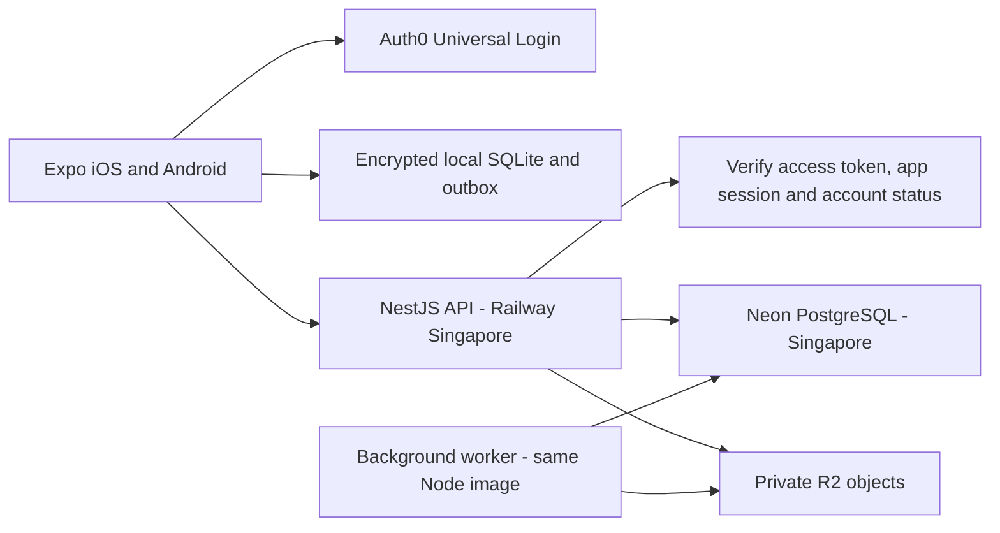

# GoGoSpend backend design

Date: 17 October 2026. Status: backend design approved by the founder, including Auth0; implementation planning authorized.

The founder approved this backend design with Auth0 on 17 October 2026 and requested the detailed implementation plan. This supersedes its earlier Firebase recommendation. Design approval authorizes planning; it authorizes no provisioning, credentials, source implementation, production reads, data migration, commits, pushes, or deployment.

## Decision brief

- **Recommendation:** retain the Expo mobile client and NestJS API; use the founder-selected Auth0, Neon PostgreSQL in Singapore, and private Cloudflare R2 Standard storage. Run API and background work as separate roles of one Node 24 application image on Railway Singapore.
- **Expected outcome:** private personal wallets, transactions, budgets, and history; exact financial calculations; retry-safe manual entries; optional offline creation; reviewed imports; export and deletion journeys matching the design previews.
- **Main tradeoff:** an API and worker remain operational responsibilities, and identity, database, and file storage use separate providers. This avoids simultaneously replacing the framework and the persistence layer.
- **Decision status:** the backend design with Auth0 is approved. Produce and review the implementation plan next. No paid subscription or implementation is authorized by this approval. Native feasibility and release verification remain prerequisites to launch.

The selected product is a Thai/English personal tracker for iOS and Android. THB is the only first-release currency. It records money; it does not execute payments, move bank funds, or establish a bank's available balance. Bank connections, shared wallets, credit-card accounting, multiple currencies, AI advice, recurring bills, and dedicated refund workflows are outside this first release.

## Verified starting point

Repository: `mygogocash/gogospend`; inspected branch `feat/standalone-client-local`, HEAD `c009c7e`. Existing local startup/extraction edits are dirty and must be preserved. No repository-local or ancestor AGENTS/CLAUDE files were found in the named instruction locations; the founder-supplied operating mandate governs this work.

| Evidence | Consequence |
| --- | --- |
| `apps/app/package.json`: Expo `~58.0.12`, React Native `0.88.0`, SecureStore | Retain the client; prove new native integrations in development builds. |
| `apps/api/package.json`: Node `>=24`, NestJS `^12.0.1`, Express `^5.1.0`, Mongoose `^9.9.5` | Retain NestJS and replace Mongo-specific persistence deliberately. These are declared ranges, not a new installed-version audit. |
| Same API package includes Firebase Admin, ExcelJS, Sharp and Tesseract | A normal Node container has the lowest runtime-port risk for existing code. Presence does not prove every package is needed at launch. |
| `apps/app/src/auth/session.ts` stores only an issued session in memory | Standalone sign-in is not implemented. |
| `apps/api/src/auth/firebase-auth.guard.ts` includes inherited backend-JWT and Firebase paths plus Mongo user resolution | Replace that inherited identity boundary with the standalone contract below; do not copy its fallback identities or legacy issuer configuration. |
| `spend-tx.schema.ts` has one wallet reference; `spend-wallet.schema.ts` has no opening balance | Transfers and opening balances need new PostgreSQL contracts, not only a connection-string change. |
| `docs/CUTOVER.md` describes a shared-Mongo extraction | That existing proposal is not authority for the new independent backend. Keep it until an approved replacement/cutover plan exists. |
| `docs/LOCAL_VERIFICATION.md` records 28 dependency advisories from earlier local verification | That is historical evidence, not a fresh audit. A new dependency/security review is required before enabling imports or release. |

No external account, database, storage bucket, credential, production dataset, or live deployment was inspected for this design.

## Recommended system

| Responsibility | Proposed choice | Boundary |
| --- | --- | --- |
| Identity | Auth0 Universal Login through `react-native-auth0` | Authorization Code with PKCE; Google, Apple and verified email/password. No SMS, guest identity or custom password handling. |
| API | Existing NestJS, Node 24 | Versioned `/v1` REST; application authorization and money commands. No direct client SQL or Data API. |
| Hosting | Railway Singapore, `asia-southeast1-eqsg3a` | Stateless API plus separate worker process using the same image. Temporary files only; no durable app volume. |
| Database | Neon PostgreSQL, `aws-ap-southeast-1` | Dedicated GoGoSpend project; separate production and non-production identities and credentials. |
| SQL access | `pg` plus Drizzle schema/migrations | Proposed new dependencies. Generated SQL is reviewed; financial operations use explicit database transactions. |
| Files | R2 Standard, private buckets | Separate upload/quarantine, accepted attachments, exports, and backup scopes. No public `r2.dev` access. |
| Local persistence | `expo-sqlite` with SQLCipher; key in SecureStore | Separate encrypted database per signed-in account. Native development builds required. |
| Background tasks | PostgreSQL job table with leases | Import parsing, exports and deletion; bounded concurrency. No Redis or distributed services initially. |
| Reminders | Native local notifications | Device-local time; opt-in permission. No remote push service required for daily reminders. |
| Monitoring | Structured redacted service logs and health/latency metrics | No financial values, notes, receipt contents, credentials, signed URLs or raw account identifiers in telemetry. |

The default production database stays warm at a small configured compute size for predictable interactive latency. Development may scale to zero. Continuous queue polling or database health probes can prevent suspension, so cost estimates below assume production compute is continuously active.

## Alternatives and exit paths

### API runtime

| Rank | Option | Expected output | Time/complexity | Cost | Main risk/tradeoff |
| --- | --- | --- | --- | --- | --- |
| 1 | **NestJS container + Neon** | Existing framework with redesigned persistence and standalone auth | Lowest framework migration effort; SQL redesign still substantial | Always-on container baseline | More hosting operations than a pure function deployment |
| 2 | Hono on Neon Functions | Small Fetch-style API close to the database | Requires API port and dependency/package feasibility proof | Active/waiting capacity and invocations, plus database | GA service, but existing Nest/Express/OCR packaging is not proven drop-in compatible |
| 3 | Hono on Cloudflare Workers + Hyperdrive | Edge API with Neon connectivity | Largest runtime port; OCR/import CPU work likely needs separate handling | Low request baseline; worker limits apply | Partial Node compatibility and a different execution model |

Executive pick: keep NestJS while changing the database. The runtime remains portable to another Node container host. Standard PostgreSQL and S3-compatible objects provide practical data exits; platform configuration and authentication identities still require migration work.

### Authentication and storage

Auth0 is the founder's chosen identity provider. Use its hosted Universal Login in the system authentication browser, with GoGoSpend branding and Thai/English text. Enable `th` and `en` and pass the selected app locale through `ui_locales`; verify each login, verification and recovery prompt. Auth0's native SDK supports Expo development/EAS builds rather than Expo Go. Its documented minimum versions are compatible in principle with this project's declared Expo/React Native versions; a real build and redirect proof remain required.

Preserve the proposed account-linking scope and separate production/development tenants by budgeting B2C Essentials or an equivalent approved entitlement. Free is a reduced-scope pilot option, not the cost assumption for the complete design. Auth0 Universal Login is a browser-mediated step: the in-app sign-in entry stays in the approved visual style, while hosted prompts use supported Auth0 branding rather than claiming an identical custom native form. Neon remains the financial database; Auth0 stores identity and credential state. Do not enable Neon Auth or retain Firebase as a parallel login issuer.

Propose Auth0 Japan for identity, subject to the selected tenant's actual regional availability and terms. Auth0's documented public-cloud list differs from Neon/Railway; Singapore financial hosting does not imply Singapore identity residency. Confirm and document the actual tenant region before provisioning.

R2 wins for private receipts and expiring import/export objects. Neon Object Storage is GA and reduces provider count, but its compatibility documentation currently says lifecycle and versioning configurations are accepted without enforcement. R2 APAC placement is a best-effort hint; this design does **not** claim guaranteed Singapore or Thailand file residency. If strict country placement becomes a requirement, use a provider with an explicit regional storage commitment before launch.

## Sign-in and account lifecycle

1. Let users explore a fictional demo without creating a real guest account. Real tracking begins after sign-in.
2. Offer Apple, Google and email/password with verified email through Auth0 Universal Login in the system authentication browser. Use the native SDK's Authorization Code with PKCE flow, exact environment-specific callback/logout allowlists, state and nonce validation. Prefer verified Universal Links/App Links for release callbacks; prove the selected callback configuration on both platforms. Never embed a client secret, collect passwords in our API, use a WebView login form or enable a password grant to imitate the prototype.
3. The SDK Credentials Manager owns protected credential persistence and rotating refresh tokens. Request the configured GoGoSpend API audience plus `openid profile email offline_access`. Send its short-lived **API access token**, not its ID token, as the Bearer credential. Propose a five-minute access-token lifetime, seven-day refresh idle limit and 30-day absolute limit, subject to tenant proof. Serialize refresh per installation so parallel requests cannot accidentally reuse a rotated token. Keep tokens out of SQLite, logs, URLs and ordinary app storage; no separate application refresh-token system.
4. Pin one Auth0 issuer, API audience, signing algorithm (`RS256`) and allowed native client IDs per environment. Validate signature through the issuer's trusted JWKS, issuer, audience, expiry/not-before, subject, authorized client and route scopes; reject opaque tokens, ID tokens and tokens for a different API. Use bounded JWKS caching/key refresh; unknown keys or unavailable required key material fail closed. Map `(issuer, sub)` to an internal account UUID; never auto-link identities merely because emails match. A trusted Auth0 profile check at session bootstrap verifies the selected connection's email-verification requirements; do not trust a writable client flag.
5. Every account/data API request also requires an opaque, server-generated application-session binding stored in device-protected storage; store only its digest server-side. It references the internal account, Auth0 subject/client, current account session generation, creation/idle/expiry and revocation state, with seven-day idle and 30-day absolute limits. It never replaces the access token or grants independent API access. The narrowly scoped, rate-limited bootstrap/challenge/reauthentication-completion endpoints can accept a verified API access token before a binding exists, but return no financial data and cannot bypass blocked-principal, deletion or revocation-pending checks. Public health/policy endpoints are separate unauthenticated exceptions. Activate a new account/binding only after step 6's proof succeeds. Read binding/account state on each data request; deleting/disabled accounts and revoked/expired bindings cannot read, write, upload, export or sync. Database failure fails closed. Writes recheck these conditions under the common account lock. This small revocation registry is necessary because an Auth0 JWT is not invalidated simply by logout or identity deletion.
6. Establish or renew a binding only through a dedicated OIDC proof endpoint: the server issues a one-use, five-minute challenge bound to the operation and current principal; the SDK performs authorization with that nonce and `max_age=0`. At this endpoint only, validate the returned ID token's signature, exact issuer/client audience and authorized party, expiry, nonce, matching subject and `auth_time` against both challenge creation and `reauth_after`, with bounded clock skew. The ID token is proof for this challenge, never a Bearer credential for financial APIs. Consume the challenge under the account lock. The binding's authenticated time cannot be refreshed by an ordinary token refresh. For export/link/global logout/deletion, require a new purpose-bound proof no more than five minutes old and consume it with the command. Auth0 can establish a new upstream federation exchange without forcing Google/Apple password re-entry; disclose that distinction and prove the flow. No client-side success boolean or biometric prompt alone is server reauthentication evidence.
7. Initial security settings provide **sign out** and **sign out of GoGoSpend everywhere**. The latter increments the account session generation, stores `reauth_after` and revokes all application bindings under the common lock, immediately denying old GoGoSpend sessions even if Auth0 JWTs have not expired. Durably retry the selected plan's supported per-user/client grant or device-credential revocation. Hold new binding creation while this provider cleanup is pending, so a delayed revocation cannot erase a newly established grant; expose retryable pending status and alert rather than bypassing the hold. Once cleanup is verified, a fresh binding must satisfy step 6 after that cutoff. Clear local credentials and the Auth0 browser session where supported. Do not claim this signs the user out of Google/Apple or every upstream browser. Per-device remote session management stays out of the first UX.
8. Auth0 provider-side changes are a separate boundary. Route operational disable/delete actions through the app's common-lock workflow before changing Auth0. A bare Auth0 Dashboard block/delete cannot instantly revoke a JWT already accepted by the API; the proposed token lifetime bounds that residual access if Auth0 stops further issuance. Password-reset/recovery must invalidate the application bindings through an authenticated, idempotent Auth0 event integration, with monitored failures and reconciliation. The exact supported post-change-password delivery/recovery path is a release feasibility gate; do not promise immediate reset revocation without proving it, or silently accept unsigned callbacks. No Enterprise-only session/refresh-token introspection is assumed on Essentials.
9. Explicit provider linking requires fresh server-verified authentication to both identities and a supported server-side Management API linking flow. Preserve the chosen internal account UUID/primary subject; reject a link between two populated financial accounts until an explicit data-merge journey exists. Never auto-link by matching email. After linking, reconcile subject aliases and invalidate old application bindings before fresh sign-in. Linking availability and exact token/endpoint behavior must be proven on the selected plan; do not freeze deprecated ID-token linking examples into the contract. Apple-linked account deletion follows the Auth0 provider-revocation ordering below.

Local sign-out warns about unsynced entries. Cancel keeps them; an explicit discard clears them. Revoke that application's binding when online, erase its local binding/SDK credentials/cache/outbox and encryption key, and clear the Auth0 browser session where possible. Offline local erasure cannot promise immediate provider-side revocation; clearly separate those outcomes. Never replay a previous account's queue into the next account. Native install/reinstall, key invalidation and account switching are test cases, not assumed guarantees.

## Data model and financial invariants

Use UUID identifiers independent of provider IDs. Every user-owned table contains `owner_id`. Composite ownership foreign keys prevent linking one account's transaction to another account's wallet, category, import or attachment.

| Entity | Essential responsibility |
| --- | --- |
| `accounts` | Auth mapping, locale, timezone, active/deleting status, `reauth_after`, session generation |
| `auth_sessions` / `reauth_challenges` | Opaque binding digest, subject/client, generation and expiry; one-use purpose/nonce challenge state without persisted tokens |
| `consents` | Versioned required terms acknowledgement and optional privacy/analytics preferences, without raw device fingerprints |
| `wallets` | Stable name/type/color, THB, opening balance, tracking start date, archive state, version |
| `categories` | Owner, expense/income type, stable built-in key, optional custom name/color; archive preserves history |
| `transactions` | One logical expense, income or owned-wallet transfer; amount, date, references, version and deletion state |
| `monthly_budgets` / `budget_category_limits` | One overall limit per account/month; optional expense-category sublimits |
| `command_receipts` | Idempotency key, normalized request digest and original command outcome |
| `account_sync_state` / `sync_changes` | Per-account committed change order and deletion tombstones |
| `attachments` | Private object reference, checksum, detected type, byte size and quarantine/ready state |
| `import_jobs` / `import_rows` | Parse/review/confirmation state, candidate duplicates and source-row identity |
| `jobs` | Task type, owner, lease token, attempts, deadline and retry state |
| `audit_events` | Minimal append-only mutation metadata; no receipt text, raw notes or credentials |
| `deletion_requests` | Cleanup progress and an erasure marker usable during restoration |

Financial rules:

- Database amounts use `bigint` integer satang. Individual positive transaction amounts are limited to `99,999,999,999` satang, matching the prototype maximum of ฿999,999,999.99. No binary floating-point calculations.
- API minor-unit values are decimal integer **strings** to avoid JavaScript overflow in accumulated totals; parse strictly. Server calculations use bigint/decimal-safe operations and explicit range checks. Display formatting never feeds financial arithmetic.
- A wallet opening balance is nonnegative setup data, capped at the same `99,999,999,999` satang. Budget amounts use the same positive cap. Once records exist, changing an opening balance requires an explicit audited correction; it is never income. Tracking dates are Gregorian `date` values; operational timestamps use `timestamptz`. First-release reporting uses `Asia/Bangkok`.
- Expense/income has one wallet and a matching category type. A transfer has two distinct, active, same-owner THB wallets and no spending category. Both sides are represented by **one transaction row**, so a transfer cannot be half-written.
- A record's date cannot precede the referenced wallet's tracking start date or be in the future for this release. Invalid dates produce a field-specific explanation. Dates are preserved independently of the phone's timezone.
- Wallet balance = opening + active income − active expenses + incoming transfers − outgoing transfers. Derive balances from records initially; do not maintain a separate mutable balance counter.
- Negative tracked balances are allowed. This is a recording tool, not payment authorization.
- Monthly income/expense/budget totals exclude opening balances and transfers. A category sublimit is part of the overall budget, not extra budget. Overall spending includes uncapped expense categories too.
- Validate budget/category-limit updates under the account lock. A deferred database constraint trigger additionally checks their aggregate does not exceed the overall limit, including changes to the parent limit.
- Renames retain stable IDs; category expense/income type is immutable. Archived categories/wallets remain available to historical reads; new entries cannot reference archived entities. Wallet archive requires a zero recorded balance and explicit user confirmation.
- Current records are editable with version checks and minimal audit evidence. This is not an immutable banking ledger. Dedicated refunds/reversals are deferred until their UX and net-spending treatment are approved; do not infer refunds or silently classify them as income.

The approved synthetic fixture remains a golden reconciliation test: opening balances ฿4,032 cash and ฿1,468 daily; income ฿28,000; expenses ฿12,450; one ฿1,500 cash-to-daily transfer. Result: cash ฿2,350 + daily ฿18,700 = ฿21,050. Two separate same-day ฿65 coffees remain valid manual entries when their command IDs differ.

## Authorization, roles and database boundaries

The mobile client receives no database password, Neon management key, R2 secret or service-account private key. It calls the API with a user token. The API derives ownership from verified identity, never from a writable request `owner_id`.

Replace the inherited shared-product allowlist/legal-service dependency with GoGoSpend-owned account and published-policy versions. Production writes/uploads require the current required acknowledgement; unavailable configuration never becomes an implicit acceptance. Account export/deletion and policy review remain accessible when a new terms version has not been accepted. Optional analytics is off by default and separate from required terms. The founder must approve and publish the actual policy text before launch; this architecture makes no legal-compliance claim.

Use explicit owner predicates and PostgreSQL row-level security as defense in depth. The normal application role is neither table owner nor superuser and has no `BYPASSRLS`. Each request uses a database transaction and `SET LOCAL`/`set_config(..., true)` for its authenticated account context; never leak session-level context through the pool. Missing context denies access. RLS is additional protection against missing predicates, not protection from a fully compromised trusted API that can set context.

Use separate migration/owner, application, background-job and deletion-maintenance roles. The worker can parse staged objects and update leased jobs; it cannot create financial transactions without user confirmation. Privileged deletion/export routines require a validated job lease and account state, a fixed search path, restricted execution grants and explicit review. No client-accessible generic SQL/RPC endpoint.

Use separate least-privilege Auth0 machine-to-machine clients for profile/link operations and for grant revocation/account-delete maintenance, with only the Management API scopes each operation requires. Cache short-lived Management API tokens within their expiry and bound retries/rate limits; do not mint one per request. Mobile clients receive none of these tokens or secrets. Scope them to the named GoGoSpend tenant; do not reuse a GoGoCash credential. Apple/Google connection credentials belong in Auth0's approved connection configuration, not in the mobile app or PostgreSQL. Any additional provider signing material needs separately authorized managed-secret setup.

Applications use a small `pg` pool against Neon's pooled endpoint; migrations use the direct endpoint. TLS certificate verification stays enabled. Migrations run once from a controlled release job, never on every API startup. No runtime credentials are created by this document.

## API and concurrency contract

Document typed OpenAPI contracts and shared validation in `packages/contracts` before implementation. Examples:

| Route family | Behavior |
| --- | --- |
| `/v1/auth/challenges`, `/v1/auth/bootstrap` | Rate-limited JWT-authenticated OIDC proof/binding establishment; no financial data before a binding exists |
| `/v1/me` and `/v1/me/reauthentication` | Profile/settings and session security state |
| `/v1/wallets`, `/v1/categories` | Create/read/update/archive with ownership and version checks |
| `/v1/transactions` | Expense/income creation; cursor-based search/filter history |
| `/v1/transfers` | One atomic transfer command with explicit source/destination |
| `/v1/transactions/:id` and `/:id/restore` | Versioned edit, soft-delete and undo |
| `/v1/budgets/:month`, `/v1/summary` | Overall/category limits and consistent scoped totals |
| `/v1/sync`, `/v1/sync/snapshots`, `/v1/commands/status` | Ordered changes, a consistent full snapshot, and reconciliation of uncertain commands |
| `/v1/imports`, `/:id/preview`, `/:id/confirm` | Upload, parse, review and selected-row confirmation |
| `/v1/exports`, `/v1/deletion-requests` | Recently authenticated privacy operations with status |

Every mutation has a client-generated command UUID. Under one PostgreSQL transaction: acquire that account's sync-state row lock, recheck account status and revocation/version conditions **under that lock**, reserve/read the idempotency receipt, validate references/version, write the mutation, allocate its change revision, write audit metadata/change payload and complete the receipt. Commit once. Deletion, disabling and global revocation acquire the same lock before their state transition. An early HTTP authentication check never substitutes for this post-lock check. Acquiring the same account lock for all writes establishes per-account commit order; do not use a bare global sequence as a commit-order cursor.

Repeating the same command returns its original compact acknowledgement. Receipt fields are limited to command ID, request digest, stable entity ID, initial version, committed change revision and outcome code: no full DTO, amount, name, note or attachment snapshot. Reusing its key with a different normalized payload returns `409 IDEMPOTENCY_MISMATCH`. Keep that minimal receipt while the account exists, including after transaction deletion, so an old retry cannot recreate a removed entry. After deletion/purge, return the acknowledgement plus current `ENTITY_DELETED`/`ENTITY_PURGED` state without reconstructing the old row. Manual content similarity is not a uniqueness constraint. Client-generated transaction IDs are additionally unique per owner.

Edits use `If-Match`/expected integer version. A stale update returns `409 VERSION_CONFLICT` with the current safe record and actions to reload or explicitly reapply. No silent last-write-wins. A transfer edit/delete/restore changes one logical row in the same protocol and therefore updates both derived wallet views together.

Errors have stable code, localized field information, request ID and optional retry delay. Use `401` for invalid/expired identity, `403` for disabled functionality or non-active account, `404` for an inaccessible object, `409` for version/idempotency conflict, `422` for field validation and `429` for rate limits. No existence leak across accounts.

History uses keyset pagination on `(occurred_on, id)` with a stable filter scope. Defaults are 50 rows, maximum 200; no hidden 200-record truncation. Date filters, search, type/category/wallet scope and sorting apply consistently to list results and their summaries.

## Offline and sync

Recommended first-release boundary: offline cached reads and **new manual expenses, income and transfers** referencing already-synced wallets/categories. Creating wallets/categories, changing budgets, editing/deleting existing records, imports, exports and account management require connectivity initially. A pending unsent entry may be edited or removed locally before first transmission; once transmission begins its immutable payload/key is frozen until its outcome is resolved.

- SQLCipher stores records, cached summaries and an outbox per account. Keep a random encryption key in SecureStore, with device-protected access. Exclude the database, keys and temporary receipts from OS backups. Native SDK configuration and key-loss behavior need device proof.
- Persist the local entry and its outbox command in one SQLite transaction before showing **Saved on device · Waiting to sync**. That label is not used until local persistence has actually succeeded.
- Show confirmed server totals and a clearly marked pending adjustment/estimated total; never make a pending total indistinguishable from confirmed history.
- Retry the same key after uncertain network outcomes, with exponential backoff and jitter, bounded in-flight work and at most one token refresh per failed request. Do not retry validation, account denial or version conflicts indefinitely.
- Fetch changes on launch, foreground, successful writes and explicit refresh. Foreground periodic refresh may be bounded to 60 seconds; real-time subscriptions are unnecessary initially. Background delivery depends on OS scheduling and is not promised.
- Revalidate identity/account before flushing. Expired identity pauses the queue; deleted/archived references become **Needs review**, with drafts preserved. Never drop queued financial data silently.
- Sync change rows carry a committed entity snapshot/version or tombstone. Allocate revisions under the per-account transaction lock. Retain changes/tombstones 30 days; expired cursors return `410 RESYNC_REQUIRED`.
- Full resync creates one consistent account snapshot and its high-water revision in the **same PostgreSQL REPEATABLE READ snapshot**. Stream bounded chunks to an immutable private temporary snapshot object/manifest; all downloaded pages reference that snapshot ID, not independent live queries. Expire the snapshot after 24 hours and cancel it on deletion. Apply the verified complete snapshot and its high-water revision in one SQLite transaction, then request changes strictly above that revision. Never advance the cursor past rows that have not been applied.
- Full resync preserves **every unresolved outbox command**, including transmitted commands whose outcome is unknown. Resolve their IDs through `/v1/commands/status` before replay or display. A compact acknowledgement never inserts its original draft as confirmed data: use the snapshot/current entity or the newer change revision. `ENTITY_DELETED`/`ENTITY_PURGED` resolves the pending command without resurrecting its former record. Retry an unknown command only with the original immutable key/payload, after ownership/reference checks. The UI distinguishes unresolved commands from never-sent drafts.
- Pending entries older than 30 days require explicit review before sending. Do not auto-submit stale records after a long absence. Lost/uninstalled unsynced data cannot be recovered from the server; disclose this at sign-out/discard and in help.
- Remote account deletion cannot instantly erase an offline device. The device that receives an authenticated accepted-deletion response erases its local cache/outbox/key after the user has explicitly confirmed discarding unsynced entries. Another device may receive only an account-denied or invalid-session error after Auth0 identity removal; a generic authentication failure cannot distinguish deletion from an ordinary ended session. Lock its cache and pause its queue, show **Session ended · Sign in again or erase local data**, and require explicit confirmation before erasing unsynced drafts. Transient outages and ordinary authentication failures never destroy queued data. Do not replay into a newly created account, even if the email matches. There is no separate former-principal token or unauthenticated deletion-status endpoint in this release, and no claim that remote device copies are automatically erased. Device-protected encrypted copies can remain until explicit local erasure or app removal; disclose this limitation alongside the server-side retention target.

## Imports, receipts, jobs and export

Enable imports only after the manual core and dependency/security gates pass. Reuse existing parser concepts where their behavior survives tests; do not inherit bank callbacks, cashback autologging, legacy raw payload retention or credentials.

1. An authenticated upload streams through the API with a 12 MiB hard byte limit and per-account quotas. This allows enforcement before accepting unbounded direct-object uploads. Accept CSV/XLSX for files and JPEG/PNG/WebP for receipts; other formats are rejected in the first release.
2. Write to a private quarantine object with a server-generated key. Validate detected type, image dimensions (maximum 20 megapixels), decompression limits, spreadsheet row/column limits and parse deadlines. Strip image metadata and re-encode supported images before accepting them. Never fetch user-supplied URLs or evaluate spreadsheet formulas/macros.
3. A durable leased job parses a maximum 5,000 candidate rows. Worker concurrency starts at one CPU-heavy parse; lease heartbeats and fencing tokens reject completion by an expired worker. A crashed worker can retry; attempts are bounded to three and permanent failures become visible/retryable jobs.
4. Display extracted fields, totals, assigned wallets and possible duplicate matches. Similarity is advisory. The user confirms selected rows and categories. Automatic extraction never writes spending records.
5. First confirmation freezes a revision of the reviewed selection, mapping and normalized fields. Confirm at most 500 selected rows in one bounded command/transaction; larger selections use explicit batches with visible progress. Commit per-row source identity, resulting transaction ID, and progress in the same transaction. Retrying an overlapping batch returns already-committed row acknowledgements and continues only untouched selected rows. Respond with committed, remaining and conflicted row IDs/counts plus the frozen revision. A changed preview requires a new explicit revision/confirmation; it cannot rewrite committed rows. Revalidate job ownership, account status and confirmation revision under the account lock. Duplicate `(import_job_id, source_row_id)` keys do not cause untouched rows to be lost or the entire import to become unrecoverable.
6. Keep raw/quarantine uploads at most 24 hours; delete them earlier after successful parsing unless the user explicitly elects to retain an accepted receipt attachment. Unconfirmed parsed previews expire after seven days. Do not treat upload success as confirmation.
7. Receipt attachments use private object keys and short-lived authenticated download grants. Signed URLs expire after five minutes and are never logged; metadata authorization is checked before issuance. A granted URL remains usable until its expiry, so account deletion also removes its object.
8. Exports use the selected period, all three transaction types, explicit source/destination columns and exact minor units/currency. Exclude receipt binaries and unnecessary identity data. Neutralize CSV formula-leading cells. Export files expire after 24 hours and download grants after five minutes. A job status is not a claim that the user downloaded the file.

Jobs and health checks keep production database compute active in the modeled budget. PostgreSQL leases, retry deadlines, idempotent outputs and recoverable failed jobs are required; an in-memory timer is not a durable queue. Use `FOR UPDATE SKIP LOCKED` plus a lease/fencing token for job claiming. Temporary object keys include job/lease identity and cannot overwrite published attachments. Before publication, check the current lease, account generation/status and cancellation state in a transaction. Deletion invalidates existing leases and cancels publishers. In-flight uploads must already have registered object keys and bounded deadlines; an output written after cancellation is deleted rather than published. A final owner-prefix/orphan sweep after all publisher deadlines have passed is required before deletion can finish. Database fencing alone is not proof that an external object was never written. Set parser memory/time limits in the worker container and instrument queue age without recording file contents.

## Deletion, privacy and recovery

Transaction deletion is soft-delete with server-side undo for 30 days; it immediately stops counting toward current totals. Purge expired deleted records, their obsolete attachments and related private change payloads after the retention window. Minimal command receipts prevent accidental recreation by retries. The UI must disclose this retention policy before release; the existing short undo interaction is not a complete retention notice.

Account deletion requires the server-validated, purpose-bound Auth0 reauthentication proof and explicit confirmation, including the local unsynced-data consequence. Auth0 documents revocation of associated Apple refresh tokens when its Management API deletes an Apple-social user. Prefer that managed path for the selected Universal Login connection rather than carrying forward the earlier native Apple-code exchange design. Before enabling Apple sign-in, prove that this connection obtains the required provider token and that deletion revokes it for both primary and linked Apple identities. An Auth0 profile deletion without the required associated token is not proof of Apple revocation. If the chosen configuration cannot satisfy the requirement, resolve a reviewed revocation path before Apple sign-in ships; do not silently omit revocation or claim a client success flag proves it.

After accepting the proof, acquire the common account lock, recheck identity/session/account status and the deletion request, mark the account deleting, revoke its application bindings, invalidate publisher leases and create the durable cleanup job in one transaction. Block reads/writes/new downloads and bootstrap for every linked principal. Persist the independent erasure marker before destructive cleanup. Revoke Auth0 grants/device credentials through the supported, proven tenant API and perform the managed user deletion, including the verified Apple-revocation path where relevant. Treat this as an irreversible identity step; cleanup must continue without requiring that deleted user to sign in again. Then remove objects/exports/staged/snapshot files, await bounded publishers and sweep orphans, and purge account-owned private rows/audit payloads. Keep minimal blocked principal mappings through the stale-token window and until required provider cleanup is verified; an old unexpired JWT or a failed provider delete cannot bootstrap an apparently new account. Each step is idempotent and retries safely. The initiating device can display **Deletion requested** after acceptance; authenticated user status polling is not assumed after identity removal. Operations retain internal cleanup status and alert on failures. Do not claim deletion complete while required cleanup is pending.

Proposed operational targets: active server application data removed within 24 hours after accepted deletion prerequisites; encrypted recovery backups age out within seven days. These are release acceptance targets, not established legal compliance or current guarantees. Keep a restricted minimal erasure registry **outside the database/backup being restored**, in a separate private R2 recovery-control scope with maintenance-only access. Markers contain opaque internal account identity and a keyed lookup value for the provider subject, without financial records. They survive restoration to a point before deletion. Clear a marker only after the last recoverable copy containing that principal has expired, including database history, manual snapshots, retained branches, object copies and restore-created backups. Prohibit production-data copies with retention beyond this window; use synthetic non-production fixtures. Inventory copy expiry as part of deletion/restore proof. Never restore a backup directly to a public serving environment.

Configure seven-day Neon point-in-time restore on an eligible paid plan. Add a daily encrypted logical backup and accepted-attachment copy to an isolated private recovery scope with seven-day lifecycle expiry. The public API must have no recovery-bucket credentials; recovery decryption material is managed separately from application runtime. Restore tests must cover both database references and attachment availability, then reapply erasure markers before traffic.

Recovery objectives: within the healthy retained-history window, target database RPO of one hour or less and RTO of four hours; a separate daily-backup disaster fallback has up to 24 hours RPO. Prove them in staging before describing them as achieved. Local unsynced entries are outside server recovery coverage.

## Operations, performance and rollout

- Validate only required configuration at startup. Secrets live in environment-specific managed stores; direct migration credentials and maintenance access are separate from API credentials. No production credentials in development.
- `/live` checks process health without touching the database; `/ready` checks dependencies with bounded timeouts. Production is budgeted warm, so frequent probes do not create a hidden scale-to-zero saving claim.
- Target warm API p95: reads under 800 ms and writes under 1,200 ms from the target Thailand test locations at an initial 20 requests/second mixed workload. These are provisional acceptance targets. Record database/queue latency separately; no benchmark was run for this document.
- Provide feature gates for new writes, imports, OCR, uploads and background work. Pausing writes leaves readable data available where safe. Timeouts, maximum batch size, per-user quotas and job concurrency bound abuse and cost.
- Emit redacted request IDs, route/status/latency, queue age, parse error codes, retry count and storage usage. Financial totals and raw identifiers do not enter logs, analytics or error payloads. Retain operational logs seven days initially.
- Alert on elevated 5xx/authorization errors, job age over five minutes, repeated cleanup failures, backup age over 26 hours and spend at 50/80/100% of the agreed monthly envelope. Budget alerts are not hard caps.
- Use database constraints, owner/date/type indexes and measured query plans before introducing caches or read replicas. No Redis, Kafka, microservices or search cluster initially.
- Reversible code releases use expand/compatible migrations, then a controlled feature switch. Once new financial writes exist in PostgreSQL, rollback must preserve those writes; switching traffic to an older Mongo store would lose data. Prefer fix-forward or a verified compatible previous API against the same PostgreSQL database.

## Cost model

Current public rates were checked on 17 October 2026. This is a sizing illustration, not a provider quote or forecast. No billable resource was created.

Assume 730 hours/month; Neon continuously at 0.25 CU; 1 GB database and 1 GB-month retained change history; two Railway roles averaging 0.5 GB RAM and 0.05 vCPU each; 2 GB outbound transfer; R2 objects within its 10 GB-month allowance and included request quotas. OCR peaks, backups, staging, builds and extra monitoring are excluded from this arithmetic.

| Item | Illustrative monthly calculation | Amount |
| --- | --- | --- |
| Neon compute | `0.25 × 730 × $0.106` | $19.35 |
| Neon database + retained history | `1 × $0.35 + 1 × $0.20` | $0.55 |
| Railway usage | `1 GB × $10 + 0.10 vCPU × $20 + 2 GB × $0.05` | $12.10 |
| Railway team plan | Pro $20 minimum includes $20 usage; apply `max($20, usage)`, not both added | $20.00 |
| R2 Standard under stated allowance | Storage and request allowances apply; no Internet egress fee | $0 in this example |
| Auth0 B2C Essentials starting tier | Published monthly starting price at 500 MAU; chosen features and final tenant entitlement must be verified before purchase | $35.00 |
| **Illustrative team-operated baseline** | Neon + Railway Pro + stated R2 use + Auth0 starting tier | **about $75/month** |

Recommend an initial **US$100/month operating envelope** with alerts and a review if exceeded. It provides some headroom, not a hard spending cap or a promise that all production costs fit. Auth0 Free advertises up to 25,000 MAU but excludes account linking and includes one tenant; Essentials starts at $35/month for 500 MAU and includes linking and three tenants. These are different feature tiers, so the Free allowance does not carry into that paid starting price. A restricted Free pilot could keep the previous infrastructure-only illustration near $40, but it does not satisfy the complete proposed identity scope. Higher MAU tiers, SMTP delivery, build services, domains, tax, additional environments and paid monitoring change the total. High OCR activity and continuously busy databases can exceed the envelope. Verify the selected plan, tenant allocation and Management API limits before purchase; none is provisioned here.

## Delivery sequence and required evidence

This is a design sequence, not authorization to implement it.

1. **Design approval recorded — complete.** The founder approved this backend design with Auth0 on 17 October 2026. Approved Home/Add/Transactions visual direction remains intact; this backend approval does not automatically approve the Wallets and remaining-page visual drafts.
2. **Write the detailed implementation plan and contracts.** Define schema migrations, DTOs, error cases and rollout gates. Preserve or separately isolate the existing dirty extraction work before source changes.
3. **Native/auth feasibility proof.** Build Expo 58 development clients on iOS and Android; prove Auth0 Universal Login/cancel/redirects, Thai/English recovery, selected-plan linking, nonce-bound session creation, simultaneous refresh/global logout, password-reset event failure/recovery, stale-token bootstrap denial, primary/linked Apple revocation, SQLCipher key behavior and account-switch isolation. None of these has run. Local preparation can precede provider setup. Before creating a provider project, storing credentials or using a billable service, obtain exact authority for that non-production target and scope. No production auth rollout is implied by a local build.
4. **Prove one complete financial slice in an isolated non-production database.** Account → wallet/opening → expense → summary → transfer → edit/delete/undo, using the golden fixture and cross-owner adversarial cases. Start with local synthetic data; hosted proof uses only the separately authorized non-production resources.
5. **Add budgets/history and offline queue.** Prove concurrent edits, duplicate requests, timeout-after-commit replay, commit-order sync, stale cursor resync, revocation, pending totals and device/account changes.
6. **Add imports, receipts, export and deletion.** Dependency remediation/review precedes parser exposure. Test malformed/decompression-heavy uploads, duplicate confirmation, worker crash/lease expiry, object authorization, CSV injection and deletion/backup restore.
7. **Verify beta readiness.** Run targeted and affected full suites, typechecks/builds, security/dependency/config review, real iOS/Android journeys, Thailand network/performance measurements and restore drills. Every gate has a PASS/FAIL/SKIPPED receipt; failed required gates mean not ready.
8. **Request exact release execution authority.** Production projects/roles/buckets/providers, managed secrets and deployment each stay within the expressly authorized environment and billable scope. Earlier non-production authorization does not authorize production. A production data migration is a separate preservation/mapping/reconciliation plan and authorization.

The default is a new independent GoGoSpend database with synthetic development fixtures. Do not read, overwrite or migrate GoGoCash production or local Mongo data automatically. Existing local Mongo data remains preserved. If existing users/data must move, inventory and preservation happen before mapping/import; compare per-user counts, dates, exact sums, duplicates and wallet ownership before any cutover. No automatic mapping by email.

The backend decisions also require a focused UX follow-up for sign-in/recovery/provider linking, versioned policy acknowledgement, pending/failed sync, conflict resolution and the precise deletion/retention wording. The existing visual previews are not proof that those newly specified states have been reviewed or implemented.

## Design review and verification status

- **PASS — financial/concurrency document review:** an independent reviewer found no remaining material contradiction in the account-lock ordering, snapshot/change boundary, unresolved-command reconciliation or resumable import contracts after revision.
- **PASS — Auth0 authentication/privacy document review:** a fresh independent review found the session-binding and managed Apple deletion contracts coherent after correcting the first-login bootstrap exception. The previous Firebase review is not reused as Auth0 evidence. Tenant/native/runtime feasibility gates remain unrun; this is not a security certification.
- **PASS — static document checks:** source-reference format, local evidence paths, final newline/whitespace, code-fence balance and absence of unresolved placeholders were checked after the Auth0 revision. Exact decimal arithmetic gives an illustrative $74.90 baseline including the stated $35 Auth0 starting tier; the integer-satang fixture remains ฿21,050.
- **PASS — `git diff --check`:** no whitespace errors in the existing tracked diff. The new untracked document also passed the separate Python whitespace assertion. Existing extraction edits were preserved; no commit was created.
- **SKIPPED — application tests, native builds, hosted auth/database integration, SQL/RLS execution, load tests and restore drills:** this change is a design document and introduces no executable behavior. Those checks are required at the delivery stages above; no runtime readiness is claimed.

## Sources and evidence limits

Sources below support provider capabilities and rates; the application contracts, limits and targets above are proposed engineering decisions. Provider documentation and billing can change. No hosted integration, native build, SQL schema execution, load test or restore was performed for this design.

- [Neon regions](https://neon.com/docs/introduction/regions), [plans and rates](https://neon.com/docs/introduction/plans), [connection pooling](https://neon.com/docs/connect/connection-pooling), [branching](https://neon.com/docs/introduction/branching).
- [Neon Functions and Object Storage GA](https://neon.com/blog/neon-backend-is-ga), [Functions runtime limits](https://neon.com/docs/compute/functions/reference/runtime-limits), [Object Storage compatibility gaps](https://neon.com/docs/storage/s3-compatibility).
- [Auth0 Expo quickstart](https://auth0.com/docs/quickstart/native/react-native-expo), [official React Native SDK requirements and credentials management](https://github.com/auth0/react-native-auth0), [Universal Login languages](https://auth0.com/docs/customize/internationalization-and-localization/universal-login-internationalization), [tenant regions](https://auth0.com/docs/get-started/auth0-overview/create-tenants).
- [Auth0 access-token validation](https://auth0.com/docs/secure/tokens/access-tokens/validate-access-tokens), [refresh rotation](https://auth0.com/docs/secure/tokens/refresh-tokens/refresh-token-rotation), [reauthentication and upstream-provider limits](https://auth0.com/docs/authenticate/login/max-age-reauthentication), [existing JWTs after logout](https://support.auth0.com/center/s/article/Invalidate-the-API-token-after-user-logout).
- [Auth0 account linking](https://auth0.com/docs/manage-users/user-accounts/user-account-linking), [linking implementation guidance](https://auth0.com/docs/manage-users/user-accounts/user-account-linking/link-user-accounts), [refresh-token revocation](https://auth0.com/docs/secure/tokens/refresh-tokens/revoke-refresh-tokens), [Management API credentials](https://auth0.com/docs/secure/tokens/access-tokens/management-api-access-tokens), [plans and feature entitlements](https://auth0.com/pricing).
- [Auth0 Apple-user deletion and associated token revocation](https://support.auth0.com/center/s/article/deleted-apple-users-receive-email-service-id-has-revoked-your-sign-in-with-apple-account), [missing Action session context during refresh](https://support.auth0.com/center/s/article/Empty-Session-Object-in-Post-Login-Actions-Event).
- [Apple account-deletion and token-revocation flow](https://developer.apple.com/documentation/technotes/tn3194-handling-account-deletions-and-revoking-tokens-for-sign-in-with-apple).
- [Expo SQLCipher support](https://docs.expo.dev/versions/latest/sdk/sqlite/#sqlcipher), [SecureStore/key and backup behavior](https://docs.expo.dev/versions/latest/sdk/securestore/).
- [PostgreSQL numeric types](https://www.postgresql.org/docs/current/datatype-numeric.html), [row-level security and owner bypass](https://www.postgresql.org/docs/current/ddl-rowsecurity.html).
- [Railway regions](https://docs.railway.com/deployments/regions), [plans and usage rates](https://docs.railway.com/pricing/plans).
- [R2 Standard pricing](https://developers.cloudflare.com/r2/pricing/), [signed access](https://developers.cloudflare.com/r2/api/s3/presigned-urls/), [location limitations](https://developers.cloudflare.com/r2/reference/data-location/).
- [Workers Node compatibility](https://developers.cloudflare.com/workers/runtime-apis/nodejs/), [limits](https://developers.cloudflare.com/workers/platform/limits/), [pricing](https://developers.cloudflare.com/workers/platform/pricing/).
